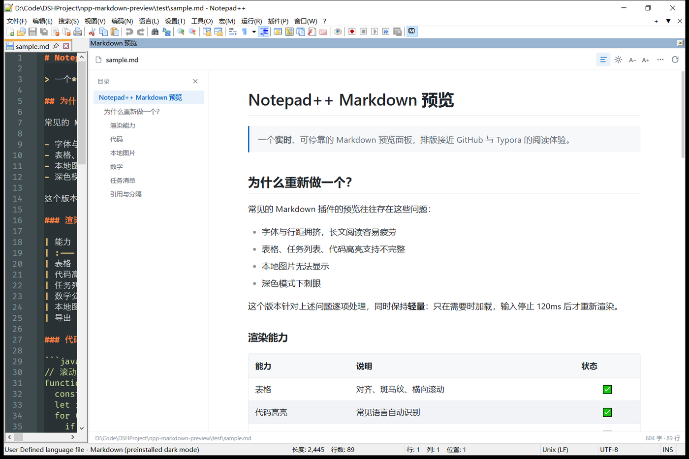
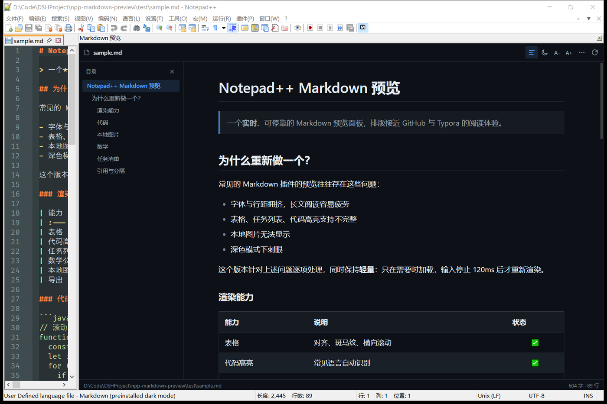
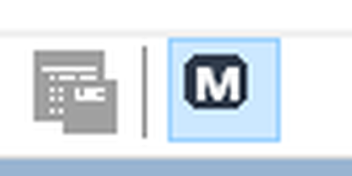

# Markdown Preview for Notepad++

English | [中文](README.md)

A Markdown preview panel for Notepad++ that looks like Typora / GitHub: docked on the right, live preview while you type — real typography, syntax highlighting, tables, math and local images.

Notepad++'s built-in Markdown highlighting is fine for editing; this panel is for reading.



Dark:



## Features

- **Typography** — built on [github-markdown-css](https://github.com/sindresorhus/github-markdown-css): an ~840 px reading column, 1.75 line height, close to GitHub / Typora
- **Syntax highlighting** — [highlight.js](https://highlightjs.org/) with automatic language detection, GitHub light/dark themes
- **Math** — [KaTeX](https://katex.org/): inline `$...$` and display `$$...$$`
- **Tables, task lists, footnotes, strikethrough** — fully supported; wide tables scroll horizontally
- **Local images** — relative paths resolve against the Markdown file's folder; absolute paths, SVG and emoji work too
- **Table of contents** — auto-generated on the left, highlights the current section while scrolling, click to jump
- **Scroll sync** — editor → preview is interpolated by heading lines; preview → editor works too
- **Themes** — light / dark / follow editor, one click from the panel toolbar
- **Export** — HTML (single file, images inlined), PDF, print
- **Light on resources** — the panel starts closed and idle; nothing runs until you open it. A skeleton screen covers the cold start, and the browser processes are released 30 s after the panel is hidden (~180 MB back)

The panel is toggled from the `M` button at the far right of the toolbar:



Cold start shows a skeleton instead of a blank rectangle:


## Requirements

- Windows 10 / 11 x64
- Notepad++ 8.x (tested on 8.8.5)
- **WebView2 Runtime** — bundled with Windows 11; on Windows 10 it is usually installed with Edge. If missing, the panel tells you and you can install the [Evergreen Runtime](https://developer.microsoft.com/microsoft-edge/webview2/)

## Install

### Option 1: prebuilt package (recommended)

1. Download [`release/npp-markdown-preview-v1.0.0.zip`](release/npp-markdown-preview-v1.0.0.zip) (~1.4 MB)
2. Extract it into the `plugins\` folder of your Notepad++ installation, so that you end up with:

   ```
   <Notepad++>\plugins\MarkdownPreview\MarkdownPreview.dll
   <Notepad++>\plugins\MarkdownPreview\WebView2Loader.dll
   <Notepad++>\plugins\MarkdownPreview\web\...
   ```

3. Restart Notepad++, open any `.md` file and click the `M` button at the far right of the toolbar (or `Plugins → Markdown 预览 → 显示 / 隐藏预览面板`, shortcut `Ctrl+Alt+P`)

> Portable installs work the same way — extract into `Notepad++\plugins\`.

### Option 2: build from source

You need [Zig](https://ziglang.org/download/) 0.13+ (used as clang + MinGW-w64 headers, **no Visual Studio required**) and Node.js (only to fetch dependencies once).

```powershell
git clone git@github.com:taojunnan/npp-markdown-preview.git
cd npp-markdown-preview

# 1. fetch build dependencies: WebView2 SDK (NuGet) + front-end libraries (npm), ~30 MB, once
powershell -ExecutionPolicy Bypass -File .\scripts\fetch-deps.ps1

# 2. build and install into Notepad++
powershell -ExecutionPolicy Bypass -File .\build.ps1 -Zig "C:\path\to\zig.exe"
```

`build.ps1` options:

```powershell
.\build.ps1 -NoInstall                       # build only, output in dist\MarkdownPreview\
.\build.ps1 -NppDir "D:\Portable\Notepad++"  # install elsewhere
.\build.ps1 -Zig "C:\tools\zig\zig.exe"      # Zig not on the default path
```

## Usage

| Action | How |
| --- | --- |
| Show / hide the panel | toolbar `M`, `Plugins → Markdown 预览 → 显示 / 隐藏预览面板`, or `Ctrl+Alt+P` |
| Refresh | `Ctrl+Alt+R` or `F5` inside the panel |
| Find in preview | `Ctrl+F` inside the panel |
| Zoom | `Ctrl+=` / `Ctrl+-`, or the `A-` / `A+` buttons |
| Theme | sun / moon / half-circle icon in the panel toolbar (light / dark / follow editor) |
| TOC | toggle with the TOC button; click an entry to jump, it follows the scroll position |
| Export | panel `⋯` menu → export HTML / export PDF / print |

- Image paths are resolved relative to the **current Markdown file**.
- The panel's open state lasts for the current session only; it starts closed after a restart.
- Edits re-render after a 120 ms debounce, so typing is not interrupted.

## Configuration

Config file: `%APPDATA%\Notepad++\plugins\config\MarkdownPreview\MarkdownPreview.ini`

| Key | Default | Meaning |
| --- | --- | --- |
| `autoOpen` | 0 | 1 = show the panel automatically when a Markdown file is opened |
| `preload` | 0 | 1 = warm up WebView2 in the background (panel opens instantly, ~180 MB resident); 0 = saves memory, shows a skeleton for ~1.5 s on open |
| `releaseOnHide` | 1 | 1 = destroy the WebView2 processes 30 s after the panel is hidden; 0 = keep them (faster to reopen) |
| `theme` | auto | `auto` / `light` / `dark` |
| `fontSize` | 16 | body font size (px) |
| `toc` | 1 | 1 = show the TOC column |
| `sync` | 1 | 1 = sync scrolling between editor and preview |

The checkable menu items map 1:1 to these keys and write back to the file.

## Uninstall

```powershell
powershell -ExecutionPolicy Bypass -File .\uninstall.ps1
```

Or simply delete `<Notepad++>\plugins\MarkdownPreview\` and `%APPDATA%\Notepad++\plugins\config\MarkdownPreview\`.

## Repository layout

```
src\plugin.cpp        plugin entry points, docked panel, editor sync, menu, toolbar button, settings
src\webview.cpp       WebView2 host (COM callbacks, resource channel, print / PDF)
src\webview.h
src\sdk\              official PluginInterface.h / Docking.h / Scintilla.h
web\index.html        panel skeleton markup
web\style.css         typography and themes
web\app.js            rendering, TOC, scroll sync, export
scripts\fetch-deps.ps1 downloads build dependencies (WebView2 SDK + npm packages)
test\                 sample documents and a standalone WebView2 host for screenshots / PDF checks
docs\shots\           README screenshots
release\              prebuilt package
```

Front-end libraries (marked, DOMPurify, highlight.js, KaTeX, github-markdown-css) are copied from
`_build\js` into `dist\...\web\vendor\` at build time, so the plugin runs fully offline.

## How it works

- Native C++ plugin; the panel is rendered by WebView2 (Chromium): `marked` parses → `DOMPurify` sanitizes → `highlight.js` highlights → `KaTeX` typesets math
- Panel assets are served through `SetVirtualHostNameToFolderMapping`; images referenced by the document are intercepted with `WebResourceRequested` and read from the file system — no HTTP involved
- Editor → preview sync interpolates by heading lines instead of a naive percentage; preview → editor uses `SCI_SETFIRSTVISIBLELINE`
- PDF export uses `ICoreWebView2_7::PrintToPdf`; HTML export inlines images as data URIs
- On a cold start the WebView2 window stays hidden until its first frame is ready; the host window paints a skeleton in the meantime, so there is no white flash

## Known limitations

- One WebView2 profile per config directory: a second Notepad++ instance cannot share it (the panel explains this; close the other window and retry)
- ~180 MB while the panel is open (inherent to a Chromium engine); released 30 s after it is hidden
- x64 only

## Credits

[marked](https://github.com/markedjs/marked) · [DOMPurify](https://github.com/cure53/DOMPurify) ·
[highlight.js](https://highlightjs.org/) · [KaTeX](https://katex.org/) ·
[github-markdown-css](https://github.com/sindresorhus/github-markdown-css)
