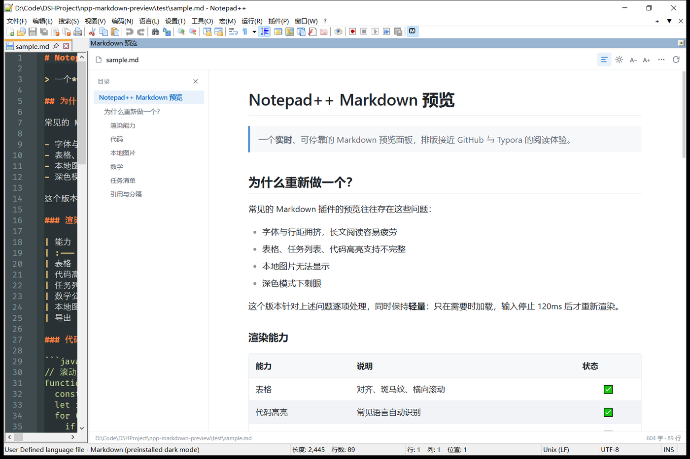
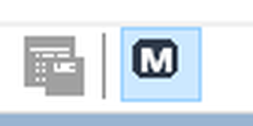

# Markdown 预览 · Notepad++ 插件

[English](README.en.md) | 中文

给 Notepad++ 加一个**像 Typora / GitHub 那样的 Markdown 预览面板**：右侧停靠，编辑即预览，排版、代码高亮、表格、数学公式、本地图片全都对得上。

内置 Notepad++ 自带的 Markdown 高亮只够看源码，这个面板负责「读起来舒服」。



深色：


## 功能

- **排版**：基于 [github-markdown-css](https://github.com/sindresorhus/github-markdown-css)，正文约 840 px 阅读栏宽、行距 1.75，接近 GitHub / Typora 的阅读体验
- **代码高亮**：[highlight.js](https://highlightjs.org/) 自动识别语言，浅色/深色两套 GitHub 配色
- **数学公式**：[KaTeX](https://katex.org/) 行内 `$...$` 与块级 `$$...$$`
- **表格 / 任务列表 / 脚注 / 删除线**：完整支持，表格可横向滚动
- **本地图片**：相对路径按 Markdown 文件所在目录解析，支持绝对路径、SVG、emoji
- **目录（TOC）**：左侧自动生成，随滚动高亮当前章节，点击跳转
- **滚动同步**：编辑器 → 预览按标题行插值定位，预览 → 编辑器反向同步
- **主题**：浅色 / 深色 / 跟随编辑器，面板右上角一键切换
- **导出**：HTML（单文件，图片内联）、PDF、打印
- **轻量**：启动时面板默认关闭，不预热时**零常驻内存**；冷启动用骨架图占位；关闭面板 30 秒后自动释放浏览器进程（约 180 MB）

打开面板的入口是工具栏最右边的小按钮：



冷启动时先显示骨架图，不会白屏：


## 环境要求

- Windows 10 / 11 x64
- Notepad++ 8.x（在 8.8.5 上验证）
- **WebView2 运行时**：Windows 11 自带；Windows 10 一般随 Edge 已安装。缺失时面板会提示，去 [Microsoft Edge WebView2](https://developer.microsoft.com/microsoft-edge/webview2/) 下载 Evergreen Runtime 即可

## 安装

### 方式一：直接下载安装包（推荐）

1. 下载 [`release/npp-markdown-preview-v1.0.0.zip`](release/npp-markdown-preview-v1.0.0.zip)（约 1.4 MB）
2. 解压到 Notepad++ 安装目录下的 `plugins\`，确保解压后是：

   ```
   <Notepad++>\plugins\MarkdownPreview\MarkdownPreview.dll
   <Notepad++>\plugins\MarkdownPreview\WebView2Loader.dll
   <Notepad++>\plugins\MarkdownPreview\web\...
   ```

3. 重启 Notepad++，打开任意 `.md` 文件，点工具栏最右边的 `M` 按钮（或菜单 `插件 → Markdown 预览 → 显示 / 隐藏预览面板`，快捷键 `Ctrl+Alt+P`）

> 便携版（portable）同理，解压到 `Notepad++\plugins\` 下即可。

### 方式二：从源码构建

需要 [Zig](https://ziglang.org/download/) 0.13+（当 clang + MinGW-w64 头文件用，**不需要 Visual Studio**）和 Node.js（仅首次拉依赖）。

```powershell
git clone git@github.com:taojunnan/npp-markdown-preview.git
cd npp-markdown-preview

# 1. 拉取构建依赖：WebView2 SDK（NuGet）+ 前端库（npm），约 30 MB，只需一次
powershell -ExecutionPolicy Bypass -File .\scripts\fetch-deps.ps1

# 2. 编译并安装到 Notepad++
powershell -ExecutionPolicy Bypass -File .\build.ps1 -Zig "C:\path\to\zig.exe"
```

`build.ps1` 支持的参数：

```powershell
.\build.ps1 -NoInstall                       # 只编译，产物在 dist\MarkdownPreview\
.\build.ps1 -NppDir "D:\Portable\Notepad++"  # 安装到别的 Notepad++
.\build.ps1 -Zig "C:\tools\zig\zig.exe"      # Zig 不在默认路径
```

## 使用

| 操作 | 方式 |
| --- | --- |
| 打开 / 关闭面板 | 工具栏 `M` 按钮、菜单 `插件 → Markdown 预览 → 显示 / 隐藏预览面板`、`Ctrl+Alt+P` |
| 刷新预览 | `Ctrl+Alt+R`，或面板内 `F5` |
| 页内查找 | 面板内 `Ctrl+F` |
| 缩放字号 | 面板内 `Ctrl+=` / `Ctrl+-`，或点 `A-` / `A+` |
| 切换主题 | 面板右上角太阳 / 月亮 / 半圆图标（浅色 / 深色 / 跟随编辑器） |
| 目录 | 点目录按钮收起/展开；点条目跳转，滚动时高亮当前章节 |
| 导出 | 面板 `⋯` 菜单 → 导出 HTML / 导出 PDF / 打印 |

- 图片路径相对于**当前 Markdown 文件**所在目录解析。
- 面板打开状态只在本次会话内保持，重启 Notepad++ 后默认关闭。
- 修改文档后 120 ms 防抖自动重新渲染，不打断输入。

## 配置

配置文件：`%APPDATA%\Notepad++\plugins\config\MarkdownPreview\MarkdownPreview.ini`

| 键 | 默认 | 说明 |
| --- | --- | --- |
| `autoOpen` | 0 | 1 = 打开 Markdown 文件时自动显示面板 |
| `preload` | 0 | 1 = 后台预热 WebView2，面板几乎秒开（常驻约 180 MB）；0 = 省内存，打开时显示骨架图，约 1.5 秒出内容 |
| `releaseOnHide` | 1 | 1 = 面板隐藏 30 秒后销毁 WebView2 进程、把内存还回去；0 = 常驻（再次打开更快） |
| `theme` | auto | `auto` / `light` / `dark`，对应面板主题按钮 |
| `fontSize` | 16 | 正文字号（px） |
| `toc` | 1 | 1 = 显示目录栏 |
| `sync` | 1 | 1 = 编辑器与预览滚动同步 |

菜单里的勾选项与配置一一对应，改菜单也会写回配置文件。

## 卸载

```powershell
powershell -ExecutionPolicy Bypass -File .\uninstall.ps1
```

或直接删除 `<Notepad++>\plugins\MarkdownPreview\` 与 `%APPDATA%\Notepad++\plugins\config\MarkdownPreview\`。

## 目录结构

```
src\plugin.cpp        Notepad++ 插件接口、停靠面板、编辑器同步、菜单、工具栏按钮、设置
src\webview.cpp       WebView2 宿主（COM 回调、资源通道、打印 / PDF）
src\webview.h
src\sdk\              官方 PluginInterface.h / Docking.h / Scintilla.h
web\index.html        面板骨架
web\style.css         排版与主题
web\app.js            渲染、目录、滚动同步、导出
scripts\fetch-deps.ps1 拉取构建依赖（WebView2 SDK + npm 包）
test\                 样例文档与独立 WebView2 宿主（截图/PDF 验证用）
docs\shots\           README 截图
release\              预编译安装包
```

前端依赖（marked、DOMPurify、highlight.js、KaTeX、github-markdown-css）在构建时从 `_build\js`
复制进 `dist\...\web\vendor\`，运行期完全离线，不访问网络。

## 实现说明

- 原生 C++ 插件，界面用 WebView2（Chromium）渲染：`marked` 解析 → `DOMPurify` 过滤 → `highlight.js` 高亮 → `KaTeX` 排公式
- 面板内容通过 `SetVirtualHostNameToFolderMapping` 映射到本地目录；Markdown 引用的图片走 `WebResourceRequested` 拦截，按文档目录读取，不经过 HTTP
- 编辑器 → 预览的滚动同步按标题行插值，而不是简单的比例换算；预览 → 编辑器用 `SCI_SETFIRSTVISIBLELINE`
- 导出 PDF 用 `ICoreWebView2_7::PrintToPdf`；导出 HTML 把图片转成 data URI
- 冷启动先把 WebView2 窗口隐藏，页面首帧就绪后再显示，中间由宿主窗口绘制骨架图，避免白屏

## 已知限制

- 一个配置目录同时只能有一个 Notepad++ 实例使用 WebView2（多开时第二个窗口会提示，关闭其它窗口后重试即可）
- 面板打开时占用约 180 MB 内存（Chromium 内核的固有成本）；关闭面板 30 秒后自动释放
- 仅提供 x64 版本

## 致谢

[marked](https://github.com/markedjs/marked) · [DOMPurify](https://github.com/cure53/DOMPurify) ·
[highlight.js](https://highlightjs.org/) · [KaTeX](https://katex.org/) ·
[github-markdown-css](https://github.com/sindresorhus/github-markdown-css)
