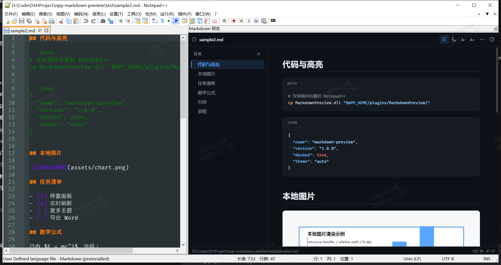

# Markdown 预览 · Notepad++ 插件

一个**停靠式、实时渲染**的 Markdown 预览面板，使用系统自带的 Edge WebView2 渲染，
排版参照 GitHub / Typora 的阅读体验，专治常见预览插件「字挤、表格丑、图片不显示、深色刺眼」。



## 功能

| 能力 | 说明 |
| --- | --- |
| 实时预览 | 输入停止约 120 ms 后重绘，不打断输入手感 |
| 排版 | GitHub 风格：标题层级、引用、表格、任务列表、删除线、分隔线 |
| 代码高亮 | highlight.js，常见 40+ 语言，代码块带语言标签与复制按钮 |
| 目录 | 自动生成 h1–h4 大纲，滚动时高亮当前章节，点击跳转 |
| 滚动同步 | 编辑器滚动 → 预览按标题锚点插值定位，阅读位置不漂移 |
| 主题 | 三态：**跟随编辑器背景** / 浅色 / 深色，自动适配你的编辑器配色 |
| 字号 | 面板内 `A− / A+` 或 `Ctrl + =` / `Ctrl + -`，记忆设置 |
| 本地图片 | 相对路径、绝对路径、中文路径、`file://` 均可显示 |
| 数学公式 | KaTeX 渲染 `$...$` 与 `$$...$$` |
| 导出 | 自包含 HTML（图片内嵌）、PDF、系统打印对话框 |
| 链接 | 点击 `http(s)` 链接用默认浏览器打开；点击相对 `.md` 链接在 Notepad++ 中打开 |
| 启动行为 | **默认关闭**，启动时不弹面板；打开 Markdown 文件时只在后台预热引擎（面板不显示），点工具栏 `M` / 菜单 / `Ctrl+Alt+P` 才打开 |
| 快速打开 | 后台预热 WebView2，点按钮时内容已经渲染好，基本无等待（可在菜单里关掉以省内存） |
| 自动显示（可选） | 菜单里可开启「打开 Markdown 时自动预览」，开启后只在打开 Markdown 文件时自动弹出 |
| 工具栏按钮 | 工具栏最右侧的 `M` 按钮，一键显示 / 隐藏预览，按钮高亮表示面板已打开 |

## 安装状态

本机已安装到：

```
D:\ProgrameFiles\Notepad++\plugins\MarkdownPreview\
    MarkdownPreview.dll      插件本体（x64）
    WebView2Loader.dll       WebView2 加载器
    web\                     前端渲染资源（HTML/CSS/JS/字体）
```

旧的 `MarkdownViewerPlusPlus` 插件已删除（若安装时 Notepad++ 仍在运行，会在它退出后自动完成删除）。

**重启 Notepad++** 后即可使用。菜单：`插件(P)` → `Markdown 预览`。

快捷键：

- `Ctrl+Alt+P` 显示 / 隐藏预览面板
- `Ctrl+Alt+R` 刷新预览
- 面板内 `F5` 刷新，`Ctrl+F` 页内查找，`Ctrl+=` / `Ctrl+-` 缩放字号

## 使用要点

- **打开预览时的加载过程**：WebView2 冷启动（浏览器进程 + 页面 + 前端脚本）大约 1.5 秒。
  点 `M` 后面板立刻出现，先显示**与正文同构的骨架图**（目录栏若干条 + 标题条 + 正文行条），
  页面就绪后无缝换成真实内容，不会出现白屏或黑屏闪烁。
  如果想让打开更快，可以勾选菜单「插件 → Markdown 预览 → 预加载预览（打开更快）」（配置 `preload=1`）：
  插件会在后台把引擎和页面准备好、把文档渲染完，点 `M` 时直接贴出成品画面（实测 120 ms 内）。
  代价是后台常驻 6 个 WebView2 进程（合计约 180 MB 私有内存），所以**默认关闭**。
- **关掉面板会自动还内存**：面板隐藏 30 秒后，插件会销毁 WebView2 进程（约 180 MB 立刻释放），
  下次打开面板再重新创建（约 1 秒，期间显示「正在渲染预览…」）。这个行为默认开启，
  可在菜单里取消勾选「关闭预览后释放内存」（配置 `releaseOnHide=0`）保持常驻。
- **什么时候打开**：启动 Notepad++ 时面板是关闭的（不占位置）。
  点工具栏最右边的 `M` 按钮、菜单「显示 / 隐藏预览面板」或 `Ctrl+Alt+P` 才会打开；
  打开的状态会在本次会话内保持，重新启动后又是关闭状态。
- **工具栏按钮**：工具栏最右边那个深色 `M` 方块就是预览开关。它在面板打开时显示为按下（浅蓝底），
  点击即可显示 / 隐藏；按钮提示文字与菜单一致。

  

- **主题**：工具栏上的主题按钮在「跟随编辑器 → 浅色 → 深色」之间循环，图标会跟着变：
  太阳 = 浅色、月亮 = 深色、半圆 = 跟随编辑器。
  「跟随编辑器」读取当前 Scintilla 的默认背景色，所以编辑器用暗色主题时预览也会变暗。
- **目录**：面板较窄时目录变为抽屉，点工具栏第一个按钮展开/收起。
- **导出**：右上角 `⋯` 菜单中「导出为 HTML…」「导出为 PDF…」；导出的 HTML 会把
  本地图片与数学字体一并内嵌，单文件即可分享。
- **图片**：Markdown 中写相对路径（相对当前 `.md` 文件）即可，例如 ``。
- **右键**：面板内右键可复制选中内容、全选、复制代码块。

## 配置

设置保存在：

```
%APPDATA%\Notepad++\plugins\config\MarkdownPreview\MarkdownPreview.ini
```

| 键 | 默认 | 说明 |
| --- | --- | --- |
| `autoOpen` | 0 | 1 = 打开 Markdown 文件时自动显示面板；默认 0（只手动打开） |
| `preload` | 0 | 1 = 后台预热 WebView2，面板几乎秒开（常驻约 180 MB）；0 = 省内存，打开时显示骨架图，约 1.5 秒出内容 |
| `releaseOnHide` | 1 | 1 = 面板隐藏 30 秒后销毁 WebView2 进程、把内存还回去；0 = 常驻（再次打开更快） |
| `theme` | auto | `auto` / `light` / `dark` |
| `fontSize` | 16 | 正文字号（11–28） |
| `toc` | 1 | 是否显示目录侧栏 |
| `sync` | 1 | 是否滚动同步 |

菜单里的「打开 Markdown 时自动预览」带勾选状态，切换会写回该文件。

## 关于旧的 MarkdownViewer++

旧插件 `plugins\MarkdownViewerPlusPlus` 已删除，对应的配置目录也一并清理。
如果它临时处于「正在被 Notepad++ 占用」的状态，安装流程会在 Notepad++ 退出后自动完成删除，
日志位于 `%TEMP%\npp-md-setup.log`；也可以手动运行：

```powershell
powershell -ExecutionPolicy Bypass -File .\finish-setup.ps1 -WaitSeconds 0
```

## 从源码构建

需要：Windows 10/11 x64、[Zig](https://ziglang.org/download/) 0.13+（当 clang + MinGW-w64 头文件用，
不需要 Visual Studio）、Node.js（仅首次拉依赖时用）。

```powershell
# 1. 拉取构建依赖：WebView2 SDK（NuGet）+ 前端库（npm），约 30 MB，只需一次
powershell -ExecutionPolicy Bypass -File .\scripts\fetch-deps.ps1

# 2. 构建并安装到 Notepad++
powershell -ExecutionPolicy Bypass -File .\build.ps1 -Zig "C:\path\to\zig.exe"
```

如果 Zig 装在默认位置（`python -m pip install ziglang`），第 2 步可以省略 `-Zig`：

```powershell
python -m pip install ziglang
powershell -ExecutionPolicy Bypass -File .\build.ps1
```

可用参数：

```powershell
# 只构建，不安装
powershell -ExecutionPolicy Bypass -File .\build.ps1 -NoInstall

# 安装到其它 Notepad++ 目录
powershell -ExecutionPolicy Bypass -File .\build.ps1 -NppDir "D:\Portable\Notepad++"

# Zig 不在默认路径时
powershell -ExecutionPolicy Bypass -File .\build.ps1 -Zig "C:\tools\zig\zig.exe"
```

目录结构：

```
src\plugin.cpp      Notepad++ 插件接口、停靠面板、编辑器同步、菜单、工具栏按钮、设置
src\webview.cpp     WebView2 宿主（COM 回调、资源通道、打印/PDF/截图）
src\webview.h
src\sdk\            官方 PluginInterface.h / Docking.h / Scintilla.h
web\index.html      面板骨架
web\style.css       排版与主题
web\app.js          渲染、目录、滚动同步、导出
test\preview_host.cpp  独立 WebView2 宿主，用于截图/PDF 验证
docs\shots\         截图
```

渲染前端依赖（marked、highlight.js、DOMPurify、KaTeX、github-markdown-css）在构建时
从本地 `_build\js` 复制到 `dist\...\web\vendor`，因此运行时完全离线。

## 排错

- **面板提示「无法创建 WebView2 环境」**：系统缺少 WebView2 运行时。
  安装 [Microsoft Edge WebView2 Runtime](https://developer.microsoft.com/microsoft-edge/webview2/)（Evergreen，x64）。
- **安装时提示 DLL 被占用**：先完全退出 Notepad++，再运行 `build.ps1`。
- **面板空白 / 样式错乱**：删除 `%APPDATA%\Notepad++\plugins\config\MarkdownPreview\WebView2`
  缓存目录后重启 Notepad++。
- **同时开两个 Notepad++ 窗口时，第二个窗口的预览打不开**：WebView2 的配置目录同一时间只能被
  一个进程使用。关掉另一个窗口再打开预览即可（提示框里也会说明这一点）。
- **图片不显示**：确认路径相对当前 `.md` 文件；绝对路径需存在且扩展名是常见图片格式。
- **中文乱码**：文档需以 UTF-8 保存（Notepad++ 状态栏可确认编码）。

## 卸载

```powershell
powershell -ExecutionPolicy Bypass -File .\uninstall.ps1
```

或手动删除插件目录与配置目录。

## 实现说明

- 插件为原生 x64 DLL，仅实现 Notepad++ 的 6 个标准导出函数；面板通过
  `NPPM_DMMREGASDCKDLG` 注册为可停靠窗口。
- 预览由 `https://nppmd.local/index.html` 提供（`SetVirtualHostNameToFolderMapping`
  指向插件内的 `web` 目录）；本地图片走 `https://mdassets.local/r?p=...` 自定义资源通道，
  因此能读取任意本地路径并返回正确的 MIME。
- 每次按键只在 `SCN_MODIFIED` 后做一次 120 ms 防抖，再把 UTF-8 文本以 JSON 推给页面；
  页面用 marked 解析、DOMPurify 清洗后重绘，重绘后恢复原阅读位置。
- 滚动同步用「源文件标题行号 ↔ DOM 标题元素」配对后线性插值，比单纯百分比更稳。
